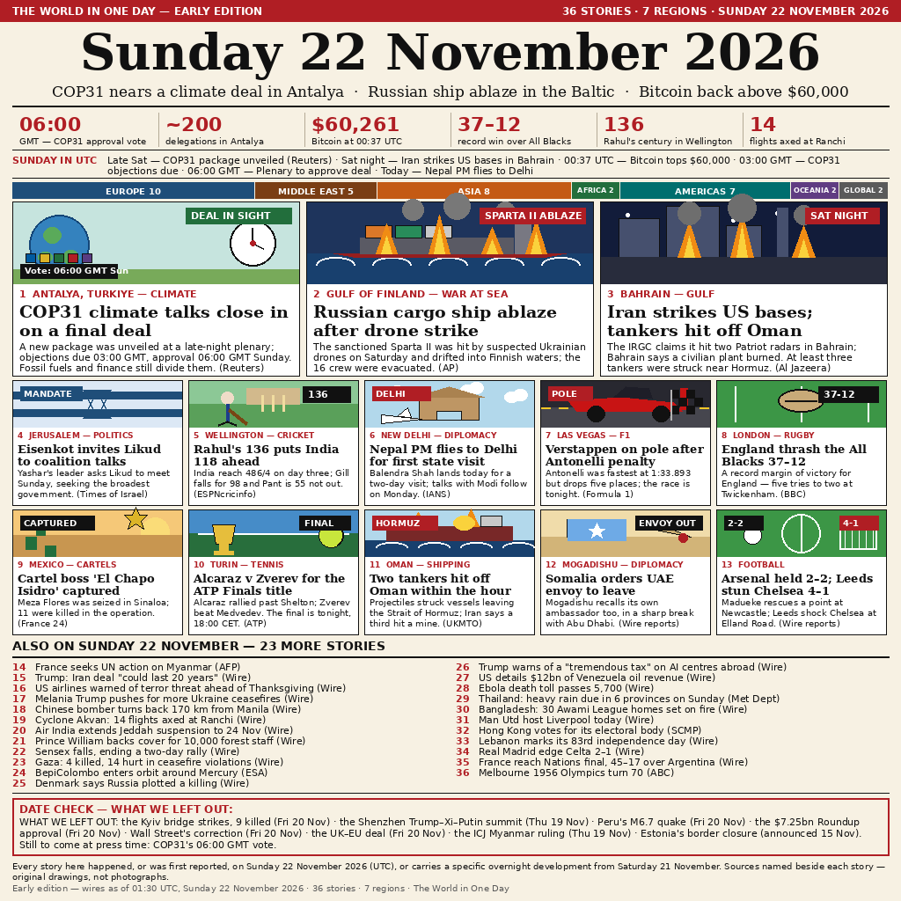

[](https://make.fun/bounty/news-image-20261122?utm_source=github&utm_medium=readme&utm_campaign=news-image-20261122)
[](https://make.fun/bounty/news-image-20261122/leaderboard?utm_source=github&utm_medium=readme&utm_campaign=news-image-20261122)
[](https://make.fun/bounty/news-image-20261122?utm_source=github&utm_medium=readme&utm_campaign=news-image-20261122)

# The World in One Day — Sunday 22 November 2026



A one-page newspaper front page summing up Sunday 22 November 2026 in
36 stories across 7 regions: 13 pictured stories, a 6-number stat strip, a
UTC timeline, region counts, a numbered "Also on Sunday" list, and a
DATE CHECK box naming what was deliberately left out as earlier news.

## Lead stories

- **COP31 close to a deal in Antalya** — a new package was unveiled at a
  late-night plenary; objections due 03:00 GMT, approval vote 06:00 GMT
  Sunday (Reuters, 22 Nov).
- **Russian cargo ship Sparta II ablaze** in the Gulf of Finland after a
  suspected drone strike; 16 crew evacuated, fire burning into Sunday
  (AP, Finnish Border Guard).
- **Iran strikes US bases in Bahrain; tankers hit off Oman** — IRGC claims
  Patriot radars hit; Bahrain says a civilian plant burned (Al Jazeera).

Every story on the page happened, or was first reported, on 21–22 November
2026, with Sunday's developments leading. Stories from 20 November or
earlier — the Kyiv bridge strikes, the Shenzhen summit, Peru's M6.7 quake,
the $7.25bn Roundup approval, Wall Street's correction, the UK–EU deal,
the ICJ Myanmar ruling, Estonia's border closure — are named in the
DATE CHECK box, not presented as Sunday news. Sources are named beside
each story. All drawings are original flat-vector art drawn in code.

## How it was built

`gen.py` draws `entry.png` (1024×1024, Python + PIL, deterministic, no
network at runtime) from the verified story list. `main.py` (standard
library only) copies `entry.png` to `/output/entry.png`, so both grader
runs write byte-identical output.

Run it locally:

```sh
python3 gen.py entry.png
mkdir -p out && MAKEFUN_OUTPUT_DIR=out python3 main.py
```

## Entry

- Competition: [news-image-20261122](https://make.fun/c/news-image-20261122)
  — "Sum up 22 November's world news in one image", $100 shared by the
  top 50 entries.
- This repository's v2 entry replaces the earlier v1 submission.
- License: MIT.
